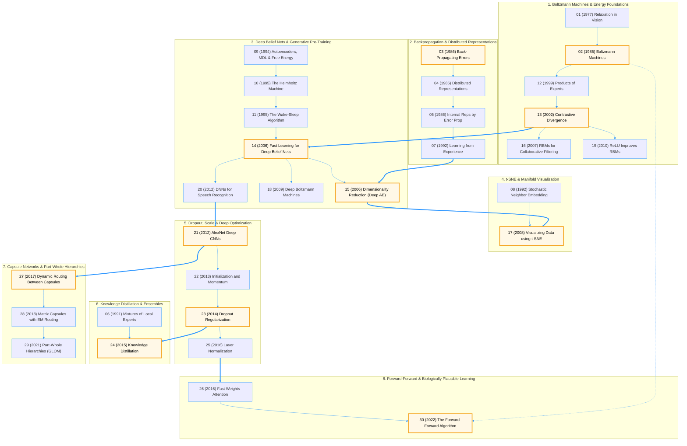

# Geoffrey Hinton Paper Replications

Educational **PyTorch** implementations of the most influential research papers by **Geoffrey Hinton and his collaborators**.

This repository follows the evolution of deep learning, from **Boltzmann Machines** and **Backpropagation** to **Deep Belief Networks**, **Dropout**, **Knowledge Distillation**, **Capsule Networks**, the **Forward-Forward Algorithm**, and **t-SNE**.

---

##  Goals

- Read and understand Geoffrey Hinton's foundational papers.
- Reproduce the core algorithms in PyTorch.
- Build clean, educational implementations.
- Visualize learning dynamics and learned representations.
- Document implementation details, assumptions, and simplifications.

---

# Paper Roadmap

# Architecture & Evolution Map

This diagram groups all 30 papers into the 8 core milestones highlighted in the repository overview. Click any node in GitHub to open its corresponding PyTorch notebook:

---

# Recommended Learning Path

If you're new to Geoffrey Hinton's work, a good progression is:

If you're new to Geoffrey Hinton's work, follow this 11-step progression through the core breakthroughs (highlighted in gold in the

[Architecture & Evolution Map](#architecture--evolution-map) above):

| Step | Milestone | Diagram Bucket & Node | Primary PyTorch Notebook | Paper Archive | Core Algorithmic Focus |
| :--- | :--- | :--- | :--- | :--- | :--- |
| **1** | **Backpropagation** | [Bucket 2 · `P03`](#architecture--evolution-map) | [📘 `#03` Back-Propagating Errors](./Learning_representations_by_back_propagating_errors.ipynb) | [📄 PDF / Manifest](./resources/papers/) | Multi-layer chain rule, hidden representation learning, and gradient flow. |
| **2** | **Boltzmann Machines** | [Bucket 1 · `P02`](#architecture--evolution-map) | [📘 `#02` Boltzmann Machines](./A_Learning_Algorithm_for_Boltzmann_Machines.ipynb) | [📄 PDF / Manifest](./resources/papers/) | Energy-based models, stochastic binary units, and thermal equilibrium. |
| **3** | **Contrastive Divergence** | [Bucket 1 · `P13`](#architecture--evolution-map) | [📘 `#13` Contrastive Divergence](./Training_Products_of_Experts_by_Minimizing_Contrastive_Divergence.ipynb) | [📄 PDF / Manifest](./resources/papers/) | Tractable $k$-step MCMC approximation ($CD\text{-}k$) for training RBMs. |
| **4** | **Deep Belief Networks** | [Bucket 3 · `P14`](#architecture--evolution-map) | [📘 `#14` Deep Belief Nets](./A_fast_learning_algorithm_for_deep_belief_nets.ipynb) | [📄 PDF / Manifest](./resources/papers/) | Greedy layer-wise unsupervised RBM pre-training followed by fine-tuning. |
| **5** | **Deep Autoencoders** | [Bucket 3 · `P15`](#architecture--evolution-map) | [📘 `#15` Dimensionality Reduction](./Reducing_the_Dimensionality_of_Data_with_Neural_Networks.ipynb) | [📄 PDF / Manifest](./resources/papers/) | Non-linear manifold compression via RBM-initialized encoder-decoder bottlenecks. |
| **6** | **t-SNE** | [Bucket 4 · `P17`](#architecture--evolution-map) | [📘 `#17` Visualizing Data using t-SNE](./Visualizing_Data_using_t_SNE.ipynb) | [📄 PDF / Manifest](./resources/papers/) | Student-$t$ kernel neighborhood probabilities to resolve the crowding problem. |
| **7** | **AlexNet** | [Bucket 5 · `P21`](#architecture--evolution-map) | [📘 `#21` AlexNet Deep CNNs](./ImageNet_Classification_with_Deep_Convolutional_Neural_Networks_AlexNet.ipynb) | [📄 PDF / Manifest](./resources/papers/) | End-to-end supervised ReLU CNNs, local response normalization, and data augmentation. |
| **8** | **Dropout** | [Bucket 5 · `P23`](#architecture--evolution-map) | [📘 `#23` Dropout Regularization](./Dropout_A_Simple_Way_to_Prevent_Neural_Networks_from_overfitting.ipynb) | [📄 PDF / Manifest](./resources/papers/) | Stochastic sub-network sampling to prevent hidden feature co-adaptation. |
| **9** | **Knowledge Distillation** | [Bucket 6 · `P24`](#architecture--evolution-map) | [📘 `#24` Knowledge Distillation](./Distilling_the_Knowledge_in_a_Neural_Network.ipynb) | [📄 PDF / Manifest](./resources/papers/) | Temperature-scaled softmax ("dark knowledge") transfer from teacher to student. |
| **10** | **Capsule Networks** | [Bucket 7 · `P27`](#architecture--evolution-map) | [📘 `#27` Dynamic Routing Capsules](./Dynamic_Routing_Between_Capsules.ipynb) | [📄 PDF / Manifest](./resources/papers/) | Vector-output capsules, squashing non-linearity, and iterative routing-by-agreement. |
| **11** | **Forward-Forward Algorithm** | [Bucket 8 · `P30`](#architecture--evolution-map) | [📘 `#30` Forward-Forward Algorithm](./The_Forward_Forward_Algorithm_Some_Preliminary_Investigations.ipynb) | [📄 PDF / Manifest](./resources/papers/) | Layer-local positive vs. negative goodness passes without backward gradient propagation. |

# Philosophy

The goal of this repository is **education rather than benchmark reproduction**.

Implementations prioritize:

- readability
- modular code
- mathematical clarity
- reproducibility
- visualization
- extensive comments

Whenever the original paper uses computationally expensive experiments, simplified versions are provided while preserving the core algorithmic ideas.

---

# Disclaimer

These implementations may use:

- smaller datasets
- reduced model sizes
- fewer training epochs
- simplified hyperparameters

They should be considered **educational reproductions**, not exact replications of the original experimental results.

---

# References

Each project includes:

- Original paper
- Mathematical derivations
- Implementation notes
- Additional resources when appropriate

---

# Author

**Mohammed Fahd Abrah**

AI Engineer • Technical Writer

---

# License

This project is released under the **MIT License**.
