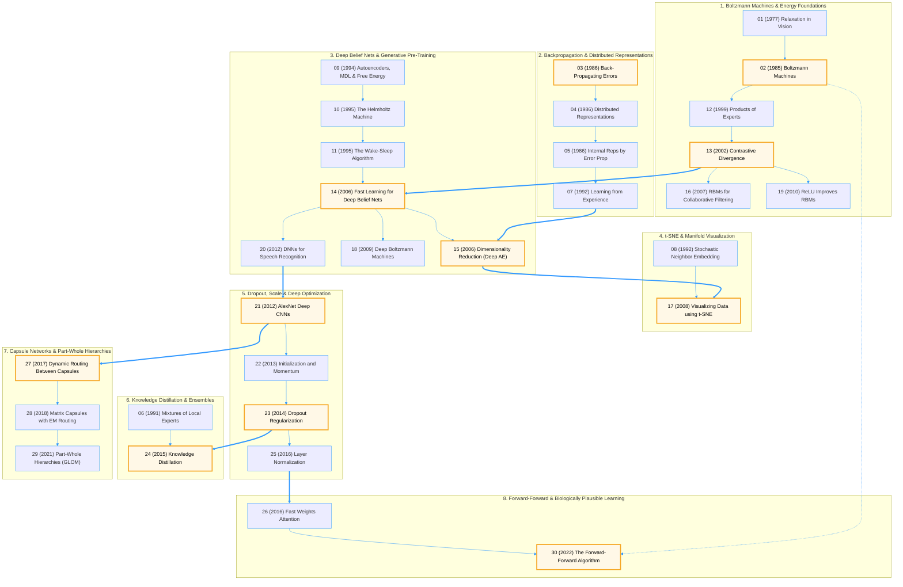

# Geoffrey Hinton Paper Replications

Educational **PyTorch** implementations of the most influential research papers by **Geoffrey Hinton and his collaborators**.

This repository follows the evolution of deep learning, from **Boltzmann Machines** and **Backpropagation** to **Deep Belief Networks**, **Dropout**, **Knowledge Distillation**, **Capsule Networks**, the **Forward-Forward Algorithm**, and **t-SNE**.

## Goals

- Read and understand Geoffrey Hinton's foundational papers.
- Reproduce the core algorithms in PyTorch.
- Build clean, educational implementations.
- Visualize learning dynamics and learned representations.
- Document implementation details, assumptions, and simplifications.

---
# Architecture & Evolution Map

This diagram groups all 30 papers into the 8 core milestones highlighted in the repository overview. The **11 Recommended Learning Path milestones** are highlighted in gold.
- **Hover** over any node to peek at a summary of the paper.
- **Click** any node to open its corresponding PyTorch notebook:

<strong>📖 Read the Story: How These 30 Papers Connect Across 45 Years (Click to Expand)</strong>

 

All 30 papers in this repository trace **one continuous scientific quest**: *How can a network of simple computing units discover the hidden structure of the world on its own?* Every arrow between buckets (`==>`) marks a moment where a bottleneck in one paradigm forced the invention of the next:

1. **Act I — Energy Landscapes & Stochastic Relaxation (`Bucket 1: #01 → #19`):** Begins in **1977 (`#01`)** with visual perception framed as constraint relaxation, leading to **Boltzmann Machines (`#02`, 1985)**—stochastic networks that learn by settling into low-energy thermal equilibrium. Because full MCMC equilibrium sampling was too slow, Hinton later introduced **Products of Experts (`#12`, 1999)** and **Contrastive Divergence (`#13`, 2002)**, proving that a single step of Gibbs sampling ($CD\text{-}1$) suffices. This unlocked **RBMs for Collaborative Filtering (`#16`, 2007)** and **ReLU units (`#19`, 2010)**.
2. **Act II — The Deterministic Pivot (`Bucket 2: #03 → #07`):** To bypass slow stochastic sampling in the 1980s, Rumelhart, Hinton, and Williams popularized **Backpropagation (`#03`, `#05`, 1986)**, propagating error gradients deterministically via the chain rule and proving that hidden layers learn compositional **Distributed Representations (`#04`, `#07`)**. Yet in the 1990s, backprop alone struggled on deep networks due to vanishing gradients and scarce labeled data.
3. **Act III — The Unsupervised Bridge (`Bucket 3: #09 → #20`):** To learn without labels, Hinton connected information theory and statistical physics via **MDL Autoencoders (`#09`, 1994)**, **The Helmholtz Machine (`#10`, 1995)**, and **Wake-Sleep (`#11`, 1995)**. In **2006**, Act I and Act II merged (`P13 ==> P14` and `P07 ==> P15`): fast Contrastive Divergence (`#13`) was used to greedily pre-train stacked RBMs in **Deep Belief Nets (`#14`, 2006)** before fine-tuning with backprop (`#07`), unlocking **Deep Autoencoders (`#15`, 2006)**, **Deep Boltzmann Machines (`#18`, 2009)**, and the breakthrough in **Speech Recognition (`#20`, 2012)**.
4. **Act IV — A Microscope for Hidden Spaces (`Bucket 4: #08 → #17`):** Once Deep Autoencoders (`#15`) learned rich high-dimensional manifolds (`P15 ==> P17`), researchers needed a way to visualize them. Evolving **SNE (`#08`, 1992)** into **t-SNE (`#17`, 2008)** replaced Gaussian neighborhoods with a heavy-tailed Student-$t$ distribution to solve the crowding problem.
5. **Act V — The Supervised Ignition (`Bucket 5: #21 → #25`):** Building on speech recognition (`P20 ==> P21`) and ReLUs (`#19`), **AlexNet (`#21`, 2012)** proved that deep supervised CNNs trained on GPUs could conquer ImageNet directly without RBM pre-training. **Initialization & Momentum (`#22`, 2013)**, **Dropout (`#23`, 2014)**, and **Layer Normalization (`#25`, 2016)** then provided the optimization and regularization toolkit for modern deep learning.
6. **Act VI — Compressing Wisdom (`Bucket 6: #06 → #24`):** Linking early **Mixtures of Local Experts (`#06`, 1991)** with the massive ensembles inspired by Dropout (`P23 ==> P24`), **Knowledge Distillation (`#24`, 2015)** showed how to compress a cumbersome teacher ensemble into a lightweight student network using temperature-softened probabilities ("dark knowledge").
7. **Act VII — Beyond Scalar Neurons (`Bucket 7: #27 → #29`):** Addressing the spatial pooling flaws of CNNs (`P21 ==> P27`), **Dynamic Routing (`#27`, 2017)**, **Matrix Capsules (`#28`, 2018)**, and **GLOM (`#29`, 2021)** replaced scalar activations with geometric pose vectors/matrices and routing-by-agreement to represent part-whole coordinate hierarchies.
8. **Act VIII — Coming Full Circle (`Bucket 8: #26 → #30`):** Returning to the biological plausibility question that began in 1985 (`P02 -.-> P30`), Hinton paired LayerNorm (`P25 ==> P26`) with associative **Fast Weights (`#26`, 2016)** and introduced the **Forward-Forward Algorithm (`#30`, 2022)**—replacing backpropagation's backward pass with contrastive positive and negative forward passes inspired by Boltzmann Machines.

---

# Paper Roadmap

> **Paper Archive & Manifest:** Local open-access PDFs, provenance metadata, and downloader scripts are maintained in [`resources/papers/`](./resources/papers/).

| # | Year | Thematic Bucket | Paper | PyTorch Notebook | Paper PDF / Archive |
| :--- | :--- | :--- | :--- | :--- | :--- |
| 01 | 1977 | **Boltzmann & Energy** | Relaxation and Its Role in Vision (PhD Thesis) | [📘 Notebook](./Relaxation_and_its_Role_in_Vision.ipynb) | [📄 PDF / Manifest](./resources/papers/) |
| 02 | 1985 | **Boltzmann & Energy** | A Learning Algorithm for Boltzmann Machines | [📘 Notebook](./A_Learning_Algorithm_for_Boltzmann_Machines.ipynb) | [📄 PDF / Manifest](./resources/papers/) |
| 03 | 1986 | **Backpropagation** | Learning Representations by Back-Propagating Errors | [📘 Notebook](./Learning_representations_by_back_propagating_errors.ipynb) | [📄 PDF / Manifest](./resources/papers/) |
| 04 | 1986 | **Backpropagation** | Distributed Representations | [📘 Notebook](./Distributed_Representations.ipynb) | [📄 PDF / Manifest](./resources/papers/) |
| 05 | 1986 | **Backpropagation** | Learning Internal Representations by Error Propagation | [📘 Notebook](./Learning_Internal_Representations_by_Error_Propagation.ipynb) | [📄 PDF / Manifest](./resources/papers/) |
| 06 | 1991 | **Distillation & MoE** | Adaptive Mixtures of Local Experts | [📘 Notebook](./Adaptive_Mixtures_of_Local_Experts.ipynb) | [📄 PDF / Manifest](./resources/papers/) |
| 07 | 1992 | **Backpropagation** | How Neural Networks Learn from Experience | [📘 Notebook](./How_Neural_Networks_Learn_from_Experience.ipynb) | [📄 PDF / Manifest](./resources/papers/) |
| 08 | 1992 | **t-SNE & Visualization** | Stochastic Neighbor Embedding | [📘 Notebook](./Stochastic_Neighbor_Embedding.ipynb) | [📄 PDF / Manifest](./resources/papers/) |
| 09 | 1994 | **Deep Belief Nets** | Autoencoders, Minimum Description Length and Helmholtz Free Energy | [📘 Notebook](./Autoencoders_Minimum_Description_Length_and_Helmholtz_Free_Energy.ipynb) | [📄 PDF / Manifest](./resources/papers/) |
| 10 | 1995 | **Deep Belief Nets** | The Helmholtz Machine | [📘 Notebook](./The_Helmholtz_Machine.ipynb) | [📄 PDF / Manifest](./resources/papers/) |
| 11 | 1995 | **Deep Belief Nets** | The Wake-Sleep Algorithm | [📘 Notebook](./The_wake_sleep_algorithm_for_unsupervised_neural_networks.ipynb) | [📄 PDF / Manifest](./resources/papers/) |
| 12 | 1999 | **Boltzmann & Energy** | Products of Experts | [📘 Notebook](./Products_of_Experts.ipynb) | [📄 PDF / Manifest](./resources/papers/) |
| 13 | 2002 | **Boltzmann & Energy** | Training Products of Experts by Minimizing Contrastive Divergence | [📘 Notebook](./Training_Products_of_Experts_by_Minimizing_Contrastive_Divergence.ipynb) | [📄 PDF / Manifest](./resources/papers/) |
| 14 | 2006 | **Deep Belief Nets** | A Fast Learning Algorithm for Deep Belief Nets | [📘 Notebook](./A_fast_learning_algorithm_for_deep_belief_nets.ipynb) | [📄 PDF / Manifest](./resources/papers/) |
| 15 | 2006 | **Deep Belief Nets** | Reducing the Dimensionality of Data with Neural Networks | [📘 Notebook](./Reducing_the_Dimensionality_of_Data_with_Neural_Networks.ipynb) | [📄 PDF / Manifest](./resources/papers/) |
| 16 | 2007 | **Boltzmann & Energy** | Restricted Boltzmann Machines for Collaborative Filtering | [📘 Notebook](./Restricted_Boltzmann_Machines_for_Collaborative_Filtering.ipynb) | [📄 PDF / Manifest](./resources/papers/) |
| 17 | 2008 | **t-SNE & Visualization** | Visualizing Data using t-SNE | [📘 Notebook](./Visualizing_Data_using_t_SNE.ipynb) | [📄 PDF / Manifest](./resources/papers/) |
| 18 | 2009 | **Deep Belief Nets** | Deep Boltzmann Machines | [📘 Notebook](./Deep_Boltzmann_Machines.ipynb) | [📄 PDF / Manifest](./resources/papers/) |
| 19 | 2010 | **Boltzmann & Energy** | Rectified Linear Units Improve Restricted Boltzmann Machines | [📘 Notebook](./Rectified_Linear_Units_Improve_Restricted_Boltzmann_Machines.ipynb) | [📄 PDF / Manifest](./resources/papers/) |
| 20 | 2012 | **Deep Belief Nets** | Deep Neural Networks for Acoustic Modeling in Speech Recognition | [📘 Notebook](./Deep_Neural_Networks_for_Acoustic_Modeling_in_Speech_Recognition.ipynb) | [📄 PDF / Manifest](./resources/papers/) |
| 21 | 2012 | **Dropout & Scale** | ImageNet Classification with Deep Convolutional Neural Networks (AlexNet) | [📘 Notebook](./ImageNet_Classification_with_Deep_Convolutional_Neural_Networks_AlexNet.ipynb) | [📄 PDF / Manifest](./resources/papers/) |
| 22 | 2013 | **Dropout & Scale** | On the Importance of Initialization and Momentum in Deep Learning | [📘 Notebook](./On_the_importance_of_initialization_and_momentum_in_deep_learning.ipynb) | [📄 PDF / Manifest](./resources/papers/) |
| 23 | 2014 | **Dropout & Scale** | Dropout: A Simple Way to Prevent Neural Networks from Overfitting | [📘 Notebook](./Dropout_A_Simple_Way_to_Prevent_Neural_Networks_from_overfitting.ipynb) | [📄 PDF / Manifest](./resources/papers/) |
| 24 | 2015 | **Distillation & MoE** | Distilling the Knowledge in a Neural Network | [📘 Notebook](./Distilling_the_Knowledge_in_a_Neural_Network.ipynb) | [📄 PDF / Manifest](./resources/papers/) |
| 25 | 2016 | **Dropout & Scale** | Layer Normalization | [📘 Notebook](./Layer_Normalization.ipynb) | [📄 PDF / Manifest](./resources/papers/) |
| 26 | 2016 | **Forward-Forward** | Using Fast Weights to Attend to the Recent Past | [📘 Notebook](./Using_Fast_Weights_to_Attend_to_the_Recent_Past.ipynb) | [📄 PDF / Manifest](./resources/papers/) |
| 27 | 2017 | **Capsule Networks** | Dynamic Routing Between Capsules | [📘 Notebook](./Dynamic_Routing_Between_Capsules.ipynb) | [📄 PDF / Manifest](./resources/papers/) |
| 28 | 2018 | **Capsule Networks** | Matrix Capsules with EM Routing | [📘 Notebook](./Matrix_Capsules_with_EM_Routing.ipynb) | [📄 PDF / Manifest](./resources/papers/) |
| 29 | 2021 | **Capsule Networks** | How to Represent Part-Whole Hierarchies in a Neural Network | [📘 Notebook](./How_to_Represent_Part_Whole_Hierarchies_in_a_Neural_Network.ipynb) | [📄 PDF / Manifest](./resources/papers/) |
| 30 | 2022 | **Forward-Forward** | The Forward-Forward Algorithm: Some Preliminary Investigations | [📘 Notebook](./The_Forward_Forward_Algorithm_Some_Preliminary_Investigations.ipynb) | [📄 PDF / Manifest](./resources/papers/) |

---

# Recommended Learning Path

If you're new to Geoffrey Hinton's work, follow this 11-step progression through the core breakthroughs (highlighted in gold in the [Architecture & Evolution Map](#architecture--evolution-map) above):

| Step | Milestone | Diagram Bucket & Node | Primary PyTorch Notebook | Paper Archive | Core Algorithmic Focus |
| :--- | :--- | :--- | :--- | :--- | :--- |
| **1** | **Backpropagation** | [Bucket 2 · `P03`](#architecture--evolution-map) | [📘 `#03` Back-Propagating Errors](./Learning_representations_by_back_propagating_errors.ipynb) | [📄 PDF / Manifest](./resources/papers/) | Multi-layer chain rule, hidden representation learning, and gradient flow. |
| **2** | **Boltzmann Machines** | [Bucket 1 · `P02`](#architecture--evolution-map) | [📘 `#02` Boltzmann Machines](./A_Learning_Algorithm_for_Boltzmann_Machines.ipynb) | [📄 PDF / Manifest](./resources/papers/) | Energy-based models, stochastic binary units, and thermal equilibrium. |
| **3** | **Contrastive Divergence** | [Bucket 1 · `P13`](#architecture--evolution-map) | [📘 `#13` Contrastive Divergence](./Training_Products_of_Experts_by_Minimizing_Contrastive_Divergence.ipynb) | [📄 PDF / Manifest](./resources/papers/) | Tractable $k$-step MCMC approximation ($CD\text{-}k$) for training RBMs. |
| **4** | **Deep Belief Networks** | [Bucket 3 · `P14`](#architecture--evolution-map) | [📘 `#14` Deep Belief Nets](./A_fast_learning_algorithm_for_deep_belief_nets.ipynb) | [📄 PDF / Manifest](./resources/papers/) | Greedy layer-wise unsupervised RBM pre-training followed by fine-tuning. |
| **5** | **Deep Autoencoders** | [Bucket 3 · `P15`](#architecture--evolution-map) | [📘 `#15` Dimensionality Reduction](./Reducing_the_Dimensionality_of_Data_with_Neural_Networks.ipynb) | [📄 PDF / Manifest](./resources/papers/) | Non-linear manifold compression via RBM-initialized encoder-decoder bottlenecks. |
| **6** | **t-SNE** | [Bucket 4 · `P17`](#architecture--evolution-map) | [📘 `#17` Visualizing Data using t-SNE](./Visualizing_Data_using_t_SNE.ipynb) | [📄 PDF / Manifest](./resources/papers/) | Student-$t$ kernel neighborhood probabilities to resolve the crowding problem. |
| **7** | **AlexNet** | [Bucket 5 · `P21`](#architecture--evolution-map) | [📘 `#21` AlexNet Deep CNNs](./ImageNet_Classification_with_Deep_Convolutional_Neural_Networks_AlexNet.ipynb) | [📄 PDF / Manifest](./resources/papers/) | End-to-end supervised ReLU CNNs, local response normalization, and data augmentation. |
| **8** | **Dropout** | [Bucket 5 · `P23`](#architecture--evolution-map) | [📘 `#23` Dropout Regularization](./Dropout_A_Simple_Way_to_Prevent_Neural_Networks_from_overfitting.ipynb) | [📄 PDF / Manifest](./resources/papers/) | Stochastic sub-network sampling to prevent hidden feature co-adaptation. |
| **9** | **Knowledge Distillation** | [Bucket 6 · `P24`](#architecture--evolution-map) | [📘 `#24` Knowledge Distillation](./Distilling_the_Knowledge_in_a_Neural_Network.ipynb) | [📄 PDF / Manifest](./resources/papers/) | Temperature-scaled softmax ("dark knowledge") transfer from teacher to student. |
| **10** | **Capsule Networks** | [Bucket 7 · `P27`](#architecture--evolution-map) | [📘 `#27` Dynamic Routing Capsules](./Dynamic_Routing_Between_Capsules.ipynb) | [📄 PDF / Manifest](./resources/papers/) | Vector-output capsules, squashing non-linearity, and iterative routing-by-agreement. |
| **11** | **Forward-Forward Algorithm** | [Bucket 8 · `P30`](#architecture--evolution-map) | [📘 `#30` Forward-Forward Algorithm](./The_Forward_Forward_Algorithm_Some_Preliminary_Investigations.ipynb) | [📄 PDF / Manifest](./resources/papers/) | Layer-local positive vs. negative goodness passes without backward gradient propagation. |

---

# Philosophy

The goal of this repository is **education rather than benchmark reproduction**.

Implementations prioritize:

- readability
- modular code
- mathematical clarity
- reproducibility
- visualization
- extensive comments

Whenever the original paper uses computationally expensive experiments, simplified versions are provided while preserving the core algorithmic ideas.

# Disclaimer

These implementations may use:

- smaller datasets
- reduced model sizes
- fewer training epochs
- simplified hyperparameters

They should be considered **educational reproductions**, not exact replications of the original experimental results.

# References

Each project includes:

- Original paper
- Mathematical derivations
- Implementation notes
- Additional resources when appropriate

# Author

**Mohammed Fahd Abrah**
AI Engineer • Technical Writer

# License

This project is released under the **MIT License**.
